  

  
  
  

 

### ✦ Hello, I'm Kim Hyun Soo!

I'm an archaeology researcher interested in ancient East Asian ceramics, pottery production techniques, and experimental archaeology.

Alongside my archaeological research, I explore how computational methods and digital technologies can support the analysis of archaeological materials.

I also enjoy developing practical digital tools to make repetitive and time-consuming research tasks simpler, more efficient, and accessible.

 

### ✦ 안녕하세요, 김현수입니다!

고고학을 연구하면서 반복적이고 번거로운 작업들을 조금 더 쉽고 편리하게 만들 방법을 고민하고 있어요.

특히 토기의 형태와 문양, 제작기술을 분석하고, 컴퓨터와 디지털 기술을 활용해 고고학 연구의 새로운 가능성을 탐색하는 데 관심이 많습니다.

- 🏺 **고고학** — 한국과 일본의 고대 토기 문화와 제작기술을 연구합니다.
- 🔥 **가마와 소성기술** — 토기의 제작 과정과 소성 환경에 따른 색조 변화를 실험과 분석을 통해 살펴봅니다.
- 🏛️ **박물관과 문화유산** — 전시와 학예 업무를 경험했으며, 연구 성과를 다양한 방식으로 전달하는 데 관심이 있습니다.
- 🌱 **디지털 고고학** — 고고학적 분석과 컴퓨터 기술을 결합하고, 연구 현장에서 활용할 수 있는 실용적인 도구를 개발하고 있습니다.

 

### ✦ はじめまして、キム・ヒョンスです！

考古学を研究するなかで、繰り返し行う煩雑な作業を、もっと簡単で使いやすくできないかと考えています。

特に、土器の形態や文様、製作技術の分析に関心があり、コンピュータやデジタル技術を活用して、考古学研究の新たな可能性を探っています。

- 🏺 **考古学** — 韓国と日本の古代土器文化や製作技術を研究しています。
- 🔥 **窯と焼成技術** — 土器の製作工程や焼成環境による色調の変化を、実験と分析を通して研究しています。
- 🏛️ **博物館と文化遺産** — 展示や学芸業務に携わった経験があり、研究成果をさまざまな形で伝えることにも関心があります。
- 🌱 **デジタル考古学** — 考古学的分析とコンピュータ技術を組み合わせ、研究現場で役立つ実用的なツールの開発に取り組んでいます。

 

---

### 🧺 Tools & Technologies

**Web Development**

  

**Programming & Image Processing**

  

**Design & Development**

  

**GIS & Spatial Analysis**

 

---

### 🕊️ Contact

  
  

For questions, feedback, or research collaboration, feel free to reach out via email or GitHub Issues.

- ✉️ **Email:** [arhyunsoo0130@gmail.com](https://mail.google.com/mail/?view=cm&fs=1&to=arhyunsoo0130@gmail.com)
- 💬 **GitHub:** [@archstudio-hs](https://github.com/archstudio-hs)
- ✦ **Leave a message:** [GitHub Issues](https://github.com/archstudio-hs/hskim-arch/issues/new)

 

---

  Archaeology · Computational Methods · Digital Heritage
   
  © 2026 archstudio-hs

